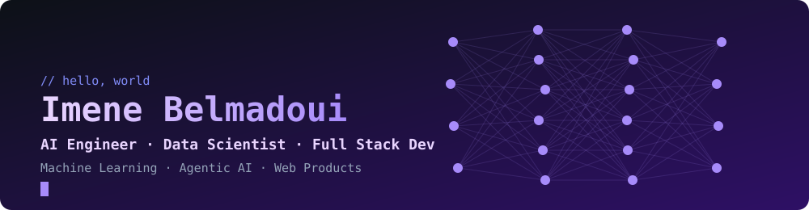

 

## `whoami`

**Data Scientist · AI Engineer · Full Stack Developer**

I design and ship intelligent products end to end: data analysis and modeling, agentic AI systems, and the web apps that put them in users' hands. I build for the Algerian and MENA market.

## `stack --data-ai`

## `stack --full-stack`

## `stack --data-infra`

## `github --activity`

  

  

  

  

